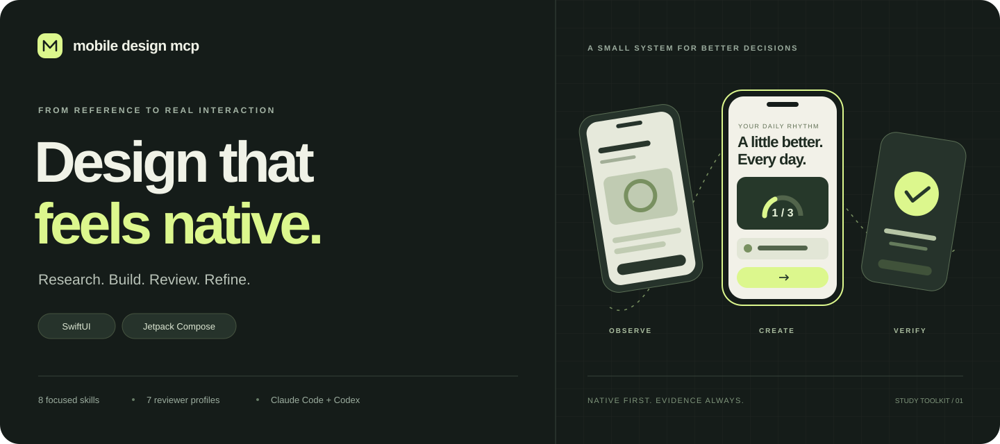
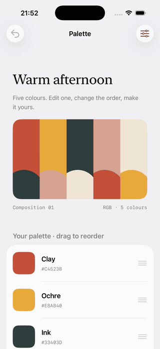
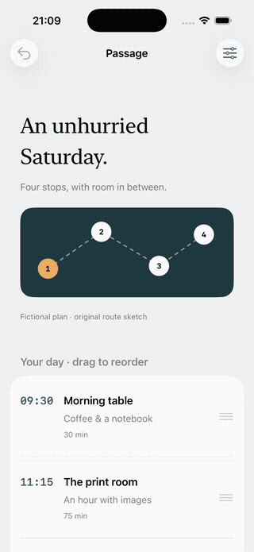
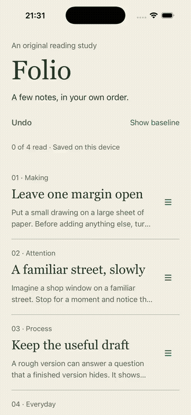
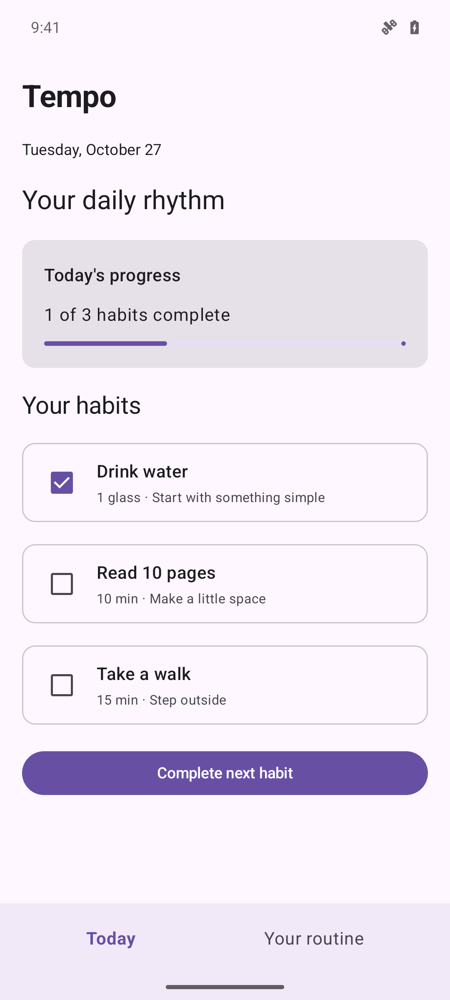
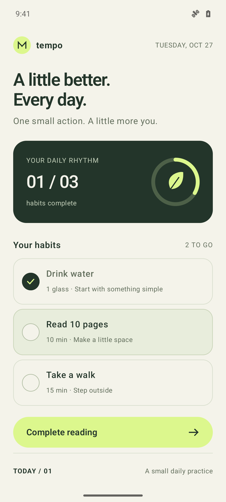

# Mobile Design MCP

**From inspiration to a native app you can actually inspect.**

A mobile design toolkit for **Claude Code and Codex**: reference research, purposeful visual systems, **SwiftUI / Jetpack Compose / Expo** implementation, independent reviews and explicit UX/performance evidence.

> **For noncommercial studies, learning and research.** Original code uses the [Noncommercial Study License](LICENSE). Marked Apache-2.0 files retain their permissions. No runtime license locks. [Rights and scope](docs/usage-rights.md).

**10 skills · 7 reviewer profiles · 18 MCP tools · Windows / macOS / Linux**

[See the native comparison](#a-small-app-two-design-approaches) · [Usage, commands and triggers](docs/usage.md) · [Install for your client](docs/clients.md) · [Explore the workflow](docs/workflow.md)

This is an early working toolkit. It supports an agent's design work; it does not certify award quality, collect native frame profiles or turn one screenshot into a complete app.

## Original iOS and Expo studies

<table>
<tr><th>Palette · colour editing</th><th>Passage · day planning</th><th>Folio · reading queue</th></tr>
<tr>
<td></td>
<td></td>
<td></td>
</tr>
</table>

Two standalone SwiftUI apps demonstrate editing, native reordering, undo,
state-backed feedback and SVG export. **Folio** adds an original Expo / React Native
reading queue. Each app includes a baseline/refined treatment of the same task
and content. [Open the studies and motion gallery](docs/studies.md) for source,
run instructions, actual captures and verification limits.

## A small app, two design approaches

**Tempo** is a real Jetpack Compose habit-completion study. Both screenshots come from the same Android emulator and APK, with the same three habits and one already complete.

<table>
  <tr><th>Conventional Material baseline</th><th>After the MCP-assisted design pass</th></tr>
  <tr>
    <td align="center"></td>
    <td align="center"></td>
  </tr>
</table>

The redesign gives the next task a specific action, groups related information, applies a small type/spacing system, and connects native progress feedback to actual state. The MCP supplied reference metadata, a brief and an authored motion recipe; the agent wrote and compiled the app.

This is an **illustrative redesign**, not an independent-agent benchmark or a measured UX improvement. Both variants were made by one author, who knew the workflow. Provider gaps and unmeasured checks remain visible. The banner above is an illustration; the comparison images are unedited emulator screenshots.

[Run the mini app](examples/tempo-android/README.md) · [Read the evidence and limitations](docs/tempo-study.md) · [Capture metadata](docs/assets/tempo-evidence.json)

## Quick start

Requires Node.js 22.13 or newer. Video analysis also requires `ffmpeg` and `ffprobe`.

The toolkit targets **Windows, macOS and Linux**, primarily through **Claude Code and Codex**. See [client installation and capability boundaries](docs/clients.md). Native build/editor prerequisites still depend on the target platform.

```bash
git clone https://github.com/noxpublishing/mobile-design-mcp.git
cd mobile-design-mcp
npm ci --ignore-scripts
npm run build
npm run index
```

The index command fetches public award metadata. The MCP server does not crawl automatically at startup. Default user library: `~/.local/share/mobile-design-mcp`; override it with `MOBILE_DESIGN_DATA_DIR`.

Start the stdio MCP process directly with:

```bash
node dist/cli.js
```

For Codex:

```bash
codex mcp add mobile_design -- node /absolute/path/to/mobile-design-mcp/dist/cli.js
```

Use a longer tool deadline for video work; see [configuration example](examples/codex.toml) and [official MCP documentation](https://learn.chatgpt.com/docs/extend/mcp?surface=cli).

## Design workflow


The working agent keeps the brief and decisions coherent. Independent reviewers receive fresh conversation contexts and bounded evidence for a particular question. They judge visible or measured results rather than inheriting the author's explanation.

The [workflow contract](docs/workflow.md) defines:

- Small role-based typography scales and named spacing relationships.
- Purposeful heading treatment, hierarchy and placement.
- Consistency without turning every screen into the same template.
- Proportionate reviews for a local edit, flow change or new direction.
- Revision-bound evidence and targeted reruns after accepted changes.
- Separate design, UX, performance and qualified-handoff outcomes.

The app's existing native themes and components remain authoritative. Review snapshots do not become another editable token database. Missing device access or profiles remain unverified work, not a passing score.

## Skills

| Skill | Purpose |
|---|---|
| [mobile-setup](skills/mobile-setup/SKILL.md) | Short initial interview, project scope/style and a durable preparation record |
| [mobile-design](skills/mobile-design/SKILL.md) | Reference-led native design, independent review and final UX/performance loops |
| [mobile-expo](skills/mobile-expo/SKILL.md) | Design, audit and refine the actual Expo / React Native project |
| [mobile-quality](skills/mobile-quality/SKILL.md) | Review hierarchy, task actions, typography, recovery and native accessibility |
| [mobile-project-docs](skills/mobile-project-docs/SKILL.md) | Useful READMEs and consistent AGENTS.md/CLAUDE.md with one canonical project context |
| [mobile-design-spec](skills/mobile-design-spec/SKILL.md) | Implementation-ready task/state, visual-system and motion contracts |
| [mobile-design-drift](skills/mobile-design-drift/SKILL.md) | Evidence-based consistency audit across decisions, source, renders and docs |
| [mobile-figma](skills/mobile-figma/SKILL.md) | Selected Figma context, assets/mappings and native implementation comparison |
| [mobile-motion](skills/mobile-motion/SKILL.md) | Native animation implementation and optional Rive authoring/integration |
| [mobile-showcase](skills/mobile-showcase/SKILL.md) | A separate product website using final app screenshots and clips after app completion |

Install all eight skills and seven reviewer definitions for both clients with the portable Node installer:

```bash
node scripts/install-workflow.mjs --client both --scope user
```

It uses real copies without symlink privileges, preserves unmanaged/modified destinations, and does not change permissions, models or account connections. See [client options](docs/clients.md) for per-project installation and update behavior. Start with `$mobile-setup` in Codex or `/mobile-setup` in Claude Code. The [reviewer profiles](docs/agents.md) are used on relevant evidence in fresh contexts; they do not run merely because they are installed.

The mobile server exposes 18 tools. Figma and Rive are optional external client connections, documented in [Figma](docs/figma.md) and [Rive](docs/rive.md). Read the [motion pipeline](docs/motion.md) for how references become native code or actual Rive assets and verified app behavior.

## MCP tools

| Tool | Capability |
|---|---|
| `get_provider_status` | Local catalog and optional provider/dependency readiness |
| `refresh_awards` | Official Apple and/or dated Google Play award metadata |
| `search_apps`, `get_app` | Search/read award and curated app references |
| `import_app` | Add a curated reference without inventing awards |
| `import_recording`, `list_recordings` | Validate, copy and hash local screenshots or videos |
| `create_flow`, `get_flow` | Annotate ordered reference steps with valid clip bounds |
| `analyze_transition` | Extract time-indexed review frames; reuse valid cached studies |
| `build_design_review_packet` | Snapshot bounded local design evidence for independent review |
| `list_motion_recipes`, `build_motion_recipe` | SwiftUI/Compose examples with explicit timing and reduced-motion behavior |
| `create_mobile_brief` | Legacy native V1 brief |
| `create_project_brief` | Explicit OS/stack V2 brief, including Expo / React Native |
| `mobbin_search_screens` | Live official REST search, with its own account entitlement |
| `mobbin_list_tools`, `mobbin_call` | Discover and call explicitly read-only official MCP tools |

The current server exposes 17 tools. Motion examples cover bottom sheets, shared elements and success feedback on both native platforms. They are authored examples, not recovered source or device-verified app builds.

## Evidence and review packets

Imported media retains content hashes separately from capture context. Identical bytes can belong to different app versions or capture circumstances; those contexts get separate records. Reference, proposed and implemented journeys must remain distinguishable.

Place a [review manifest](examples/design-review.json) at the native project root and add actual project-local captures. Call `build_design_review_packet` with absolute manifest/output paths and a mode: consistency, discoverability, motion, accessibility or performance.

The packet builder:

- Checks declared revision/hash consistency and local path boundaries.
- Copies at most eight evidence assets, 8 MiB per asset and 20 MiB of evidence in total.
- Separately includes up to eight design-source snapshots of at most 128 KiB each.
- Includes canonical design-source snapshots for consistency checks.
- Withholds rationale, rules and reference examples in discoverability mode.
- Marks missing required evidence inconclusive.
- Does not start reviewers, establish build identity or certify UX/performance.

A frame interval is not a measured transition duration. Haptics, gesture timing and original easing/spring parameters remain unknown without supporting evidence. The [performance run template](examples/performance-run.json) starts explicitly unmeasured; native collectors must supply real profiles.

Awwwards is consulted through an available external MCP or normal web research. This server does not bundle an Awwwards connection. iOS simulator builds/profile collection require a suitable Mac/Xcode environment; recordings can be imported on another host.

## Mobbin connection

The local library and native tools work without Mobbin. To connect your own eligible account:

```bash
npm run mobbin:login
```

The explicit login command displays an authorization URL and listens on a loopback callback. It uses the official OAuth flow with PKCE and state checking, and saves credentials with private file permissions in the user library. A real account is required to verify access.

A supplied OAuth token can alternatively use `MOBBIN_MCP_ACCESS_TOKEN`. REST uses a different credential, `MOBBIN_API_KEY`, and its documented Team/Enterprise entitlement. An `.env` file is not loaded automatically; provide variables through the server's launch environment.

The current REST schema supports `ios` and `web`, not Android. This native toolkit exposes the iOS subset and rejects Android REST requests before sending them. MCP tools are discovered from the connected account; the bridge forwards only tools explicitly annotated read-only.

Provider answers remain live and are not copied into the local reference corpus. See [connection details](docs/mobbin-connection.md), [source boundaries](docs/sources.md) and the providers' own terms.

## Verification and limits

```bash
npm test
npm run smoke
```

Tests run offline, including media/provenance, FTS, flow bounds, platform diagnostics, native recipes, OAuth storage and review packet isolation. Video tests need ffmpeg/ffprobe.

The smoke test starts the real stdio MCP server, uses temporary local state and fetches the public award sources live. Its generated report goes to ignored `.artifacts/live-smoke.json`. It does not imply an authenticated Mobbin test or native rendering/profiling.

Apple Design Awards and Google Play Best of are different recognitions. Google Play remains labeled as a broad app award with region/year, not a UI-design prize. Award metadata does not include current screens or measured animations.

The independent workflow review and resulting changes are summarized in [review notes](docs/design/review-summary.md). Native UI rendering, real-user research and final app performance verification must still be performed for each actual app project.

## License and acknowledgments

Original runtime code and unmarked project documentation use the custom [Noncommercial Study License](LICENSE). You may inspect, modify and redistribute them for the permitted study purposes, retaining the license and notices. Commercial use by recipients requires separate permission. This is a public, source-available project; it is not offered as unrestricted open-source software.

Adapted workflow files explicitly marked Apache-2.0 retain that license and its permissions. Dependencies and reference content retain their own rights. See [NOTICE](NOTICE), [Apache license](LICENSES/Apache-2.0.txt) and [usage and content rights](docs/usage-rights.md). A study label does not clear rights in third-party screens, graphics, fonts or brands.
