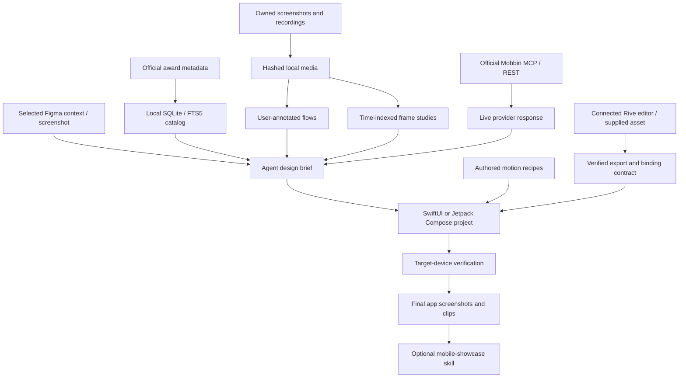

# Native design reference pipeline

The [setup and focused skills](../README.md#skills), [portable reviewer profiles](agents.md) and [cross-platform client installer](clients.md) organize the agent's work. Figma and Rive are external client connections; the mobile server reports those boundaries without claiming connectivity. `scripts/sync-agent-context.mjs` preserves manual instructions while linking a canonical project context. None of these instruction files are an autonomous background workflow engine.

`server.ts` defines the MCP contract. `store.ts` persists app references, owned media records, flow annotations and refresh metadata. `awards.ts` and `google-awards.ts` fetch explicitly bounded official listings. `media.ts` validates/imports files and extracts video study frames. `recipes.ts` supplies authored native examples with platform prerequisites. `mobbin.ts` is an account-connected live provider; its results are not stored in SQLite. `mobbin-login.ts` owns the explicit user sign-in workflow.

The design keeps observed metadata, user annotations, inferred interpretations and authored code distinct. Screenshots have no timing evidence. A selected video interval is not a measured transition duration. Haptics and original spring/easing values remain unknown unless new evidence can establish them. There is deliberately no single similarity or "award quality" score. Native build/render verification is a later app-project operation.

The two skills are separate: `mobile-design` guides native app work; `mobile-showcase` applies only after design completion and an authorized website phase. The latter can use Awwwards tools for web references when available, while all showcased app screens must come from the finished app. The optional site does not drive changes back into the app implicitly.
