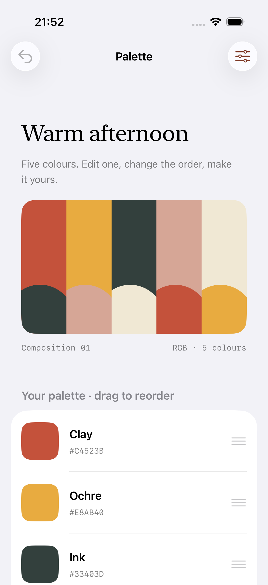
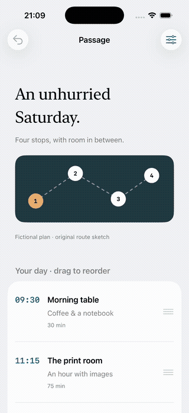
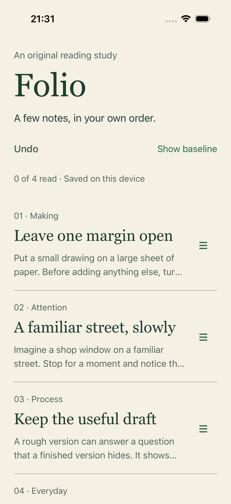

# Original mobile interaction studies

These apps use authored content and real native controls. Baseline and refined
treatments share content, state and tasks; they are illustrations, not independent
comparisons or measured UX improvements.

## Palette · SwiftUI

[Run Palette](../examples/palette-ios/README.md) ·
[Capture receipt](../examples/palette-ios/evidence/receipt.json)

Tap a colour to expand its RGB editor. Save or cancel, reorder the five stable
colours, undo changes and export a real SVG through the native file destination.
The motion excerpt is resized from an iOS simulator recording.

On 2026-10-27, four model/persistence tests and four native UI journeys passed
with Xcode 26.2 / iOS 26.2. A separate dark-mode run at accessibility-extra-large
text verified editor-action reachability. The OS Reduce Motion preference was
actually enabled during its reorder/return task. Export verification includes
cancellation, destination confirmation and inspection of the written five-colour
SVG with its circular accents. [Open the actual exported artwork](../examples/palette-ios/evidence/Palette.svg).

## Passage · SwiftUI

[Run Passage](../examples/passage-ios/README.md) ·
[Capture receipt](../examples/passage-ios/evidence/receipt.json)

Arrange four fictional stops. Arrival times remain unchanged on reorder, so a
conflict stays visible. The native sheet supports time edits, cancellation and
two detents; undo restores prior state. Four model/persistence tests and three
native UI journeys passed on the same Xcode/iOS toolchain. A separate dark-mode
run at accessibility-extra-large text verified sheet actions.

## Folio · Expo / React Native

[Run Folio](../examples/expo-study/README.md) ·
[Capture receipt](../examples/expo-study/evidence/receipt.json)

Arrange four original reading notes, open a native detail modal, change read
status and undo. Expo SDK 55, React Native 0.83.10 and Reanimated 4 are pinned for
Xcode 26.2. The iOS Release build, five domain/persistence tests, native reading/
reordering/persistence journeys, a held-drag app interruption and the same core
journey with the OS Reduce Motion switch enabled passed. A separate dark-mode
run at accessibility-extra-large text verified detail and return actions.
Android execution is not established by the iOS checks.

## Tempo · Jetpack Compose

The existing [Tempo study](tempo-study.md) remains the Android habit-completion
example, with its original build/capture metadata. The new iOS apps have different
content and tasks; their recordings come from actual iOS runs.

## Evidence boundaries

Receipts identify app-source bytes and published media hashes without local host
paths or credentials. PNGs are unedited native screenshots; motion excerpts are
trimmed/resized, and GIFs are sampled at 12 fps for GitHub. Encoded frame rate is
not a measurement of native frame pacing.

Physical-device acceptance, VoiceOver/TalkBack, representative user research and
native performance profiles are not established by these screenshots or tests.
These app-authored interactions do not verify every snippet emitted by the MCP
motion-recipe generator. No external reference screen library is included.

Each shipped review manifest uses default-size captures with unique evidence IDs.
Dark/enlarged-text captures keep their exact OS category in the receipt and are
kept out of that single-scale packet. A packet retains explicit acceptance gaps;
assembling it does not mark an independent review complete.
