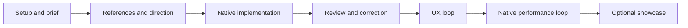

# Usage, commands and triggers

This guide explains the public toolkit from installation to a verified native
design handoff. Its original code is offered for noncommercial studies, learning
and research under the [applicable license scopes](usage-rights.md).

## Understand the parts

| Part | Responsibility |
|---|---|
| Codex or Claude Code | The working agent: reads the request, implements native code, calls tools and integrates findings |
| Eight skills | Focused instructions for setup, design, documentation, specifications, drift, Figma, motion and a later showcase |
| MCP server | Seventeen tools for reference metadata, local captures, flows, motion examples, briefs and bounded review packets |
| Seven reviewer profiles | Independent questions about visual, task, accessibility, platform, motion, performance and documentation evidence |
| Project documents | Accepted scope, decisions, source ownership, evidence and unresolved work that survive a chat session |

The client manages the configured stdio MCP process. The agent drives the workflow
during the task you started. No background file watcher automatically redesigns
an app or rechecks every screen after every save. Installing an agent profile
does not establish that a review ran.

## Install once on a workstation

Requires Node 22.13+; CI uses Node 24. Video studies need `ffmpeg` and `ffprobe`
on PATH. These terminal commands work on Windows, macOS and Linux:

```text
git clone https://github.com/noxpublishing/mobile-design-mcp.git
cd mobile-design-mcp
npm ci --ignore-scripts
npm run build
npm run index
node scripts/install-workflow.mjs --client both --scope user
```

Indexing retrieves official award metadata. Installation creates real skill folders
and client-specific reviewer definitions, preserving unmanaged or modified
destinations. It does not change models, permissions, credentials or MCP connections.
See [client installation](clients.md) for scope and update behavior.

Register the runtime for one or both clients, replacing the placeholder with the
actual absolute path to your checkout:

```text
codex mcp add mobile_design -- node "/ABSOLUTE/PATH/mobile-design-mcp/dist/cli.js"
claude mcp add --scope user --transport stdio mobile-design -- node "/ABSOLUTE/PATH/mobile-design-mcp/dist/cli.js"
```

On Windows, a forward-slash path such as `C:/Projects/mobile-design-mcp/dist/cli.js`
avoids backslash escaping. Use the actual Node executable path if the client's
PATH differs from your terminal. Verify registration:

```text
codex mcp list
claude mcp get mobile-design
```

Restart the client if newly installed skills/agents are absent. Normal operation
does not require another terminal running `npm start`; the client manages its
MCP subprocess. Official references: [Codex MCP](https://developers.openai.com/codex/mcp),
[Claude Code MCP](https://code.claude.com/docs/en/mcp).

## Start in the actual app project

Open your app directory in the agent client. The toolkit supplies reusable tools
and instructions; the app owns its brief, source, theme and components.
For a new project, enter this in the **agent chat**, not the terminal:

```text
$mobile-setup

Prepare a noncommercial daily-habit app study for iOS with SwiftUI
and Android with Jetpack Compose. Ask only consequential missing
questions and document scope, direction, constraints and next steps.
```

In Claude Code use `/mobile-setup`. Setup reuses known answers and normally records
them in `docs/design/project.md` or an existing equivalent. Resume that record after
relevant changes instead of repeating the interview before every small edit.

Then start implementation:

```text
$mobile-design

Implement the agreed scope. Research available references, propose
different directions where a choice is still needed, and implement
the chosen native design. Use relevant independent reviewers,
then the UX loop and native performance loop. Record actual checks
and remaining gaps.
```

Codex can select a relevant skill from its description or use an explicit
`$skill-name`; Claude Code can select it or use `/skill-name`. Explicit invocation
makes your intent clear. Selection is a client/agent decision, not a deterministic
keyword hook. See [Codex skills](https://developers.openai.com/codex/skills) and
[Claude Code skills](https://code.claude.com/docs/en/skills).

## Choose a focused skill

| When | Codex chat | Claude Code chat |
|---|---|---|
| New project or consequential scope reset | `$mobile-setup` | `/mobile-setup` |
| Native design, implementation or redesign | `$mobile-design` | `/mobile-design` |
| README and project instruction files | `$mobile-project-docs` | `/mobile-project-docs` |
| Accepted direction needs a detailed contract | `$mobile-design-spec` | `/mobile-design-spec` |
| Decisions, code, renders or docs may have drifted | `$mobile-design-drift` | `/mobile-design-drift` |
| Work from selected Figma nodes | `$mobile-figma` | `/mobile-figma` |
| Design/build native or Rive motion | `$mobile-motion` | `/mobile-motion` |
| Present a completed app on an optional website | `$mobile-showcase` | `/mobile-showcase` |

The main design skill routes to relevant modes. A local correction does not need
all skills or all reviewers. Documentation uses thin `AGENTS.md`/`CLAUDE.md` entry
points and one canonical project context, preserving existing instructions.
These documents carry decisions into later sessions; they do not automatically
reproduce the full conversation.

## Follow the sequence



References inform concrete decisions. An award alone does not establish a current
screen's appearance or motion. A new direction normally compares two or three
meaningfully different treatments unless it is already selected or delegated.
Unavailable sources remain evidence gaps.

Native source defines semantic type roles, purposeful heading placement,
heading-to-description and description-to-control spacing, padding and component
states. Two or three base type sizes are a starting point, with accessibility
scaling and justified exceptions. Anti-slop findings identify a concrete hierarchy,
task or consistency problem instead of banning visual styles by name.

After changes, render affected states again and inspect relevant shared uses.
Update canonical source, decisions and replacement evidence together. An old
review becomes stale when its implementation, state or device assumptions change.

The UX loop checks complete tasks, feedback, cancellation, errors and recovery.
The final performance loop uses real native profiles on defined devices/scenarios
and comparable conditions. A recipe, screenshot or opinion cannot establish frame
performance. See the [shared contract](workflow.md).

## Use independent reviewers

The profiles are `mobile-visual-reviewer`, `mobile-ux-reviewer`,
`mobile-accessibility-reviewer`, `mobile-platform-reviewer`,
`mobile-motion-reviewer`, `mobile-performance-reviewer` and `mobile-docs-reviewer`.
The working agent dispatches relevant profiles when delegation is available and
authorized, or you can request them explicitly:

```text
Use mobile-visual-reviewer and mobile-ux-reviewer in separate fresh
contexts. Review current evidence, fix confirmed issues within the
agreed direction and rerun affected checks.
```

These are agent names in a request, not slash commands. Reviewers inspect bounded
evidence and return findings; the main agent integrates corrections. The
[dispatch protocol](agents.md) covers fresh contexts, blind-review isolation,
read-only inspection and missing evidence. A default two-round correction budget
escalates unresolved decisions; it does not convert them into a passing result.

## Connect optional services

| Source | Role and boundary |
|---|---|
| Mobbin | Native examples through eligible account access; current REST adapter exposes iOS, not Android |
| Awwwards | Art direction through available web research or an external MCP; no bundled connector |
| Figma | Selected nodes through a separately connected official service; no automatic two-way sync |
| Rive | Suitable animated graphics through a real asset/editor connection; UI motion may remain entirely native |

For Mobbin, run `npm run mobbin:login` in the toolkit checkout and complete the
actual account flow. MCP and REST have separate access requirements.

For Figma, connect the official endpoint, for example in Codex:

```text
codex mcp add figma --url https://mcp.figma.com/mcp
codex mcp login figma
```

Or register it in Claude Code and use that client's `/mcp` authentication UI:

```text
claude mcp add --scope user --transport http figma https://mcp.figma.com/mcp
```

Rive's supported desktop editor must be running on its supported macOS/Windows
host. Its documented local MCP endpoint can be registered with:

```text
codex mcp add rive --url http://127.0.0.1:9791/mcp
claude mcp add --scope user --transport http rive http://127.0.0.1:9791/mcp
```

Use only the client commands you need and inspect existing configuration before
adding a same-named server. A configured endpoint does not prove account access
or editor readiness. Loopback refers to the client host. Details:
[Mobbin](mobbin-connection.md), [Figma](figma.md), [Rive](rive.md), [motion](motion.md).

Motion work specifies purpose, trigger, state ownership, interruption, lifecycle
and reduced motion. The MCP ships bottom-sheet, shared-element and success-feedback
recipe families for both native stacks; the agent implements other effects in the
app. A Rive edit needs a real exported asset and verified binding contract before
it is described as a running app animation.

## Completion, persistence and platform requirements

Design implementation, UX review and measured performance are separate results.
Missing required evidence produces a qualified handoff. A showcase starts after
verified app completion unless explicitly requested as provisional with unresolved
checks preserved. Awards are not guaranteed.

iOS builds, simulators and profiles need a Mac with Xcode. Android needs its own
build/device tooling. The cross-platform workflow does not remove native-tool
requirements. App source and committed project documents travel with Git;
credentials, the local reference database and capture library are machine-local.
Refresh references or import permitted captures on another workstation.

## Verify and publish the public study distribution

Run these terminal commands in the toolkit checkout:

```text
npm test
npm run smoke
npm run check:publication
```

Tests cover toolkit behavior. The smoke test uses the actual stdio server and
public award sources. Publication checks inspect license labeling and common
leaks; they do not certify app UX, native performance or third-party content rights.
GitHub pushes and pull requests trigger toolkit CI on Linux, macOS and Windows.

Keep credentials, personal captures, runtime databases, internal notes and generated
build outputs outside publication. Review permitted media and applicable notices
before an authorized release. See [usage rights](usage-rights.md).

The [Tempo example](../examples/tempo-android/README.md) demonstrates an actual
Android baseline/redesign capture and narrow completion/undo checks. Its
[evidence record](tempo-study.md) keeps incomplete verification explicit.
